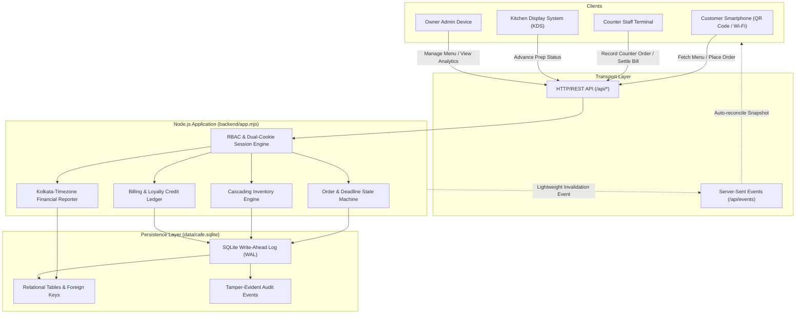
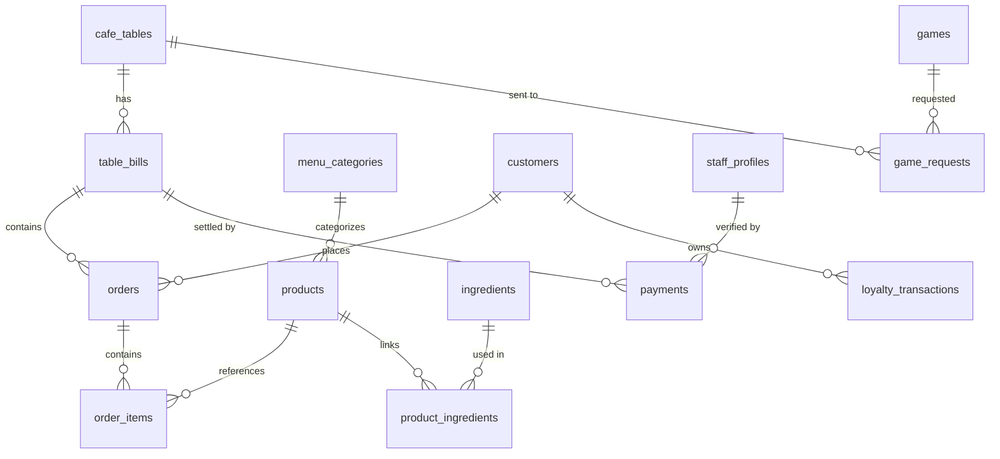

# SM Cafinity × ATOMZ · Engineering & Architecture Overview

A comprehensive guide explaining **what** SM Cafinity is, **how** it was built, and the **technical and functional architecture** powering the platform.

---

## 1. Executive Summary

**SM Cafinity** is a modern, smart café operating system engineered for board game cafés and boutique dining experiences. It unifies customer digital self-ordering, kitchen operations, physical board game lending, bill settlement, customer loyalty coins, and owner business analytics into one coherent, local-first platform.

```
┌────────────────────────────────────────────────────────────────────────┐
│                              SM CAFINITY                               │
└────────────────────────────────────────────────────────────────────────┘
          │                                              │
          ▼                                              ▼
 ┌───────────────────┐                         ┌───────────────────┐
 │   CUSTOMER VIEW   │                         │    STAFF VIEW     │
 └───────────────────┘                         └───────────────────┘
   • QR Table Binding                            • Kitchen Display (KDS)
   • Visual Menu & Variations                    • Counter / Walk-in POS
   • 15s Grace Cancellation                     • Board Game Lending
   • Live Order Tracking                         • Bill Settlement (Cash/UPI)
   • Board Game Requests & Suggestions           • Ingredient Stock Cascades
   • Loyalty Coin Wallet                         • Owner Reports & Audits
```

---

## 2. Technology Stack & Design Principles

| Layer | Technologies | Rationale |
|---|---|---|
| **Frontend** | React 19, TypeScript 5.7, Vite 6, Tailwind CSS 4, Lucide React | Blazing-fast compilation, strict typing, responsive glassmorphism UI, zero-dependency icon rendering. |
| **Backend** | Node.js 22+ (`node:http`, `node:sqlite`, `node:crypto`, `node:fs`) | Single-runtime, zero-external-dependency production server. Uses Node's built-in SQLite engine (`DatabaseSync`). |
| **Database** | SQLite 3 (WAL Mode + Strict Foreign Keys) | Single-file zero-config database (`data/cafe.sqlite`). High concurrency via Write-Ahead Logging (WAL) and immediate multi-table transactions. |
| **Real-Time** | Server-Sent Events (SSE) via `/api/events` | Lightweight, robust push mechanism over HTTP; automatically reconnects with 15-second keepalive heartbeats. |
| **Hosting & Cloud** | Render (Node.js Web Service) + Cloudflare Edge / Vercel SPA proxy | Dual deployment model: runs 100% locally on physical café Wi-Fi or 24/7 in cloud environments. |

---

## 3. High-Level System Architecture



---

## 4. Key Engineering & Technical Aspects

### 4.1 Strict Integer Paise Financial Modeling
Floating-point mathematics (e.g. `0.1 + 0.2 = 0.30000000000000004`) causes precision loss in monetary applications. In SM Cafinity:
- Every currency figure (`price`, `total`, `discount`, `amount`, `balance`) is strictly stored as an **integer number of paise** (1 INR = 100 paise; e.g. ₹250.00 is stored as `25000`).
- Formatting to `₹` occurs strictly at the presentation boundary in the frontend via `Intl.NumberFormat('en-IN', ...)`.

### 4.2 SQLite in WAL Mode with Immediate Transactions
- Database initializes with:
  ```sql
  PRAGMA journal_mode = WAL;
  PRAGMA busy_timeout = 5000;
  PRAGMA foreign_keys = ON;
  ```
- All multi-table mutations (such as creating an order, applying a discount, recording payment, or voiding a bill) are executed within `BEGIN IMMEDIATE ... COMMIT / ROLLBACK` transactions. This prevents SQL lock contention and deadlocks under concurrent ordering.

### 4.3 Zero-Leak SSE Real-Time Protocol
Instead of streaming sensitive, unencrypted order records over a shared WebSocket channel:
1. When any data mutation occurs, the server sends a minimal invalidation signal:
   ```http
   event: change
   data: {}
   ```
2. Connected clients immediately trigger an authenticated request to `GET /api/snapshot`.
3. The server inspects the caller's session token and scopes the response:
   - **Guests / Customers:** Receive only their own orders and sanitized table totals (no other guests' personal notes or customer IDs).
   - **Staff:** Receives active kitchen tickets, table bills, and game requests.
   - **Owner:** Receives full staff rosters, setting controls, and financial audit logs.

### 4.4 Idempotency & Resiliency
- Every checkout and payment submission generates a client-side UUID (`idempotency_key`) and SHA-256 payload hash (`request_hash`).
- A database constraint `UNIQUE(session_token, idempotency_key)` prevents double-charging or duplicate orders caused by bad network retries or double-taps.

### 4.5 Dual HTTP-Only Cookie Session Model
- Staff/owner authentication lives in the `cafe_staff` cookie.
- Customer dining sessions live in the `cafe_session` cookie.
- Both use `HttpOnly; SameSite=Strict; Path=/`. This allows a café manager to test customer ordering on the same machine without invalidating their staff login.

---

## 5. Core Functional Capabilities (What Was Built)

### 5.1 Customer Dining & Table QR Ordering
- **Table Token Security:** Tables have unique cryptographic tokens (e.g. `/?table=4&token=...`). The server validates the token to ensure the order belongs to a genuine physical table.
- **Grace-Period Cancellation:** Once submitted, an order enters `CANCELLATION_PENDING` for a configurable window (10–15 seconds) with an animated countdown ring. Customers can change their mind and cancel before the kitchen sees the order.
- **Automated Deadline Advancer:** A 200 ms server interval loop (and on-demand request sweeps) automatically promotes expired pending orders to `NEW` in the kitchen, completely independent of the customer's browser clock.

### 5.2 Kitchen Display System (KDS)
- Interactive Kanban queue displaying tickets by chronological urgency:
  $$\text{NEW} \longrightarrow \text{PREPARING} \longrightarrow \text{READY} \longrightarrow \text{SERVED}$$
- Shows table numbers, order item quantities, customized options (e.g. *Oat Milk*, *Extra Espresso Shot*), special preparation notes, and elapsed preparation timers.

### 5.3 Cascading Ingredient Stock System
- Dishes are linked to multiple raw ingredients in a many-to-many relationship (`product_ingredients`).
- If an ingredient (e.g. *Milk*) is toggled **Out of Stock**, every dependent menu item (e.g. *Cappuccino*, *Cold Coffee*) instantly switches to **Sold Out** across all customer devices in real-time, while independent items (e.g. *Black Coffee*, *French Fries*) remain orderable.

### 5.4 Board Game Lending Library
- Physical game catalog tracking `quantity_total` and `in_use` copies.
- Customers can view games suitable for their group size and submit a table request.
- Staff interface displays game requests with one-click **Mark Delivered** and **Mark Returned** tracking.
- **Community Game Suggestions:** Customers can suggest new games the café should purchase, earning reward coins (subject to a 30-day anti-spam cooldown).

### 5.5 Table Billing, UPI/Cash Settlement & Voids
- Orders placed by different patrons at the same table automatically aggregate into a single `OPEN` table bill.
- Settleable via **Cash** or **UPI** (enforcing a minimum 4-character transaction reference for bank reconciliation).
- **Payment Correction Workflow:** If an error occurs, the owner can void a payment with a required reason. The bill reopens, and all earned loyalty points are reversed with a logged audit entry.

### 5.6 Two-Phase Loyalty Coin Engine
- **Atomic Coin Spend:** When redeeming coins for discounts at checkout, coins are immediately locked in `RESERVED` status. If the order is cancelled during the grace window, the coins are returned. When the bill is paid, they transition to `APPLIED`.
- **Net-Spend Accrual:** Coins are awarded only on the net amount actually paid (excluding discounts and voided bills).

### 5.7 Owner Analytics & Business Controls
- **Kolkata Timezone Reporting:** Grouped into Today, This Week (Monday-start), and This Month periods.
- **Demand Forecasting:** Tally of sold quantities and estimated ingredient servings consumed.
- **Excel/Accounting Export:** Single-click CSV download formatted for accounting with apportioned line-item discounts.
- **Audit Trails:** Immutable records (`audit_events`) logging staff logins, menu edits, price adjustments, voids, and setting changes.

---

## 6. Database Schema Reference

The system is defined in `backend/migrations/001_initial.sql`:



---

## 7. Directory Structure & Key Files

```
sm-cafinity/
├── Start-Cafinity.command     # macOS one-click launcher
├── Start-Cafinity.bat         # Windows one-click launcher
├── package.json               # Scripts and dependencies
├── render.yaml                # Cloud deployment blueprint
├── vercel.json                # Vercel SPA routing & API proxy
├── backend/                   # Zero-dependency Node.js server
│   ├── server.mjs             # Entrypoint, port binding (0.0.0.0)
│   ├── app.mjs                # API routes, SSE, RBAC, business logic
│   ├── store.mjs              # SQLite WAL wrapper, transactions, seeds
│   └── migrations/            # SQL schema definitions
├── data/
│   └── cafe.sqlite            # Persistent SQLite database
├── src/                       # React 19 Frontend
│   ├── main.tsx               # DOM entrypoint
│   ├── App.tsx                # Complete UI (Customer, Kitchen, POS, Admin)
│   ├── types.ts               # Domain type definitions
│   ├── api.ts                 # HTTP & SSE client
│   ├── MenuProduct.tsx        # Product card component
│   ├── CoinWheel.tsx          # Loyalty animation
│   └── TimerRing.tsx          # Cancellation countdown ring
├── dist/                      # Compiled production bundle
└── docs/                      # Technical documentation
```
